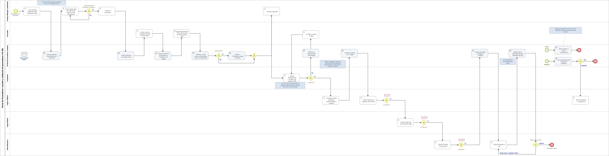

# Manual de usuario del portal de proveedores

Este manual explica el uso del portal según el rol de cada persona. Las pantallas visibles dependen del rol: el menú lateral solo muestra lo que cada usuario puede hacer.

| Rol | Quién es | Qué puede hacer |
|---|---|---|
| Proveedor | Empresa o persona que quiere ser proveedor | Completar su ficha, subir documentos, ver el estado de su solicitud |
| PM (`pm_user`) | Persona que solicita el alta de un proveedor | Crear la solicitud, invitar al proveedor, seguir el proceso de sus solicitudes |
| Administrador PM (`pm_admin`) y administrador del portal (`admin_portal`) | Administración del proceso | Todo lo anterior, crear proveedores manualmente, administrar usuarios internos, enviar a SAP |
| Administrador de área (`admin_area`) y usuario de área (`usuario_area`) | Áreas que validan (por ejemplo Contraloría, Finanzas, Datos Maestros) | Revisar documentos y aprobar, observar o rechazar en su área |
| Auditor (`auditor`) | Control interno | Consultar todo, exportar listados y ver la bitácora. No puede modificar nada |

## Visión general del proceso

## 1. Ingreso y cuenta (todos los roles)

**Usuarios internos.** En la pantalla de ingreso se usa el botón de cuenta Microsoft de la empresa. No hay clave propia que recordar.

**Proveedores.** Se ingresa con el correo y la clave definidos al activar la invitación.

- **Olvidé mi clave.** En la pantalla de ingreso, el enlace «¿Olvidaste tu clave?» pide el correo y envía un enlace de un solo uso, válido 60 minutos. Por seguridad, el mensaje es el mismo exista o no la cuenta. Se permiten 3 solicitudes por hora.
- **Clave segura.** La clave nueva debe cumplir la política de complejidad que muestra la pantalla.
- **Bloqueo.** Tras 5 intentos fallidos la cuenta se bloquea 15 minutos. Recuperar la clave también la desbloquea.
- **Mi cuenta** (menú de usuario): datos del perfil, cambio de clave, preferencias de notificación por tipo, apariencia y último ingreso.

## 2. Proveedor

1. **Recibir la invitación.** Llega un correo con un enlace de activación. Al abrirlo, se indica el tipo de proveedor (Nacional o Extranjero) y se crea la clave. Para proveedores nacionales el RUT se valida con su dígito verificador; si está mal escrito, el sistema lo indica y pide corregirlo.
2. **Completar la ficha.** Datos de la empresa, contacto, datos bancarios, representante legal y declaraciones (por ejemplo conflicto de interés). Los campos obligatorios se señalan en pantalla. La región y la comuna se eligen desde listas.
3. **Subir documentos.** Cada documento requerido aparece con su estado: *Pendiente*, *En revisión*, *Observado* o *Aprobado*. Se sube el archivo (PDF o imagen) desde el mismo ítem. Si un documento queda *Observado*, se lee el comentario de quien lo revisó y se vuelve a subir.
4. **Recordatorios.** Si hay documentos pendientes, el portal envía un recordatorio cada 3 días. También avisa cuando un documento vigente está por vencer (30 días antes) o ya venció.
5. **Seguir el estado.** El proveedor ve en qué etapa está su solicitud. Cuando todas las áreas aprueban, queda *Aprobado* y se informa por correo.

## 3. PM (solicitante)

1. **Crear solicitud.** Menú *Proveedores → Crear*. Se ingresan los datos preliminares del proveedor, incluido el RUT (se valida en el momento) y el correo de contacto.
2. **Declaración del solicitante.** Se completa la declaración de conflicto de interés, que es requisito previo para invitar.
3. **Invitar.** El sistema envía la invitación al correo del proveedor. Desde el seguimiento se puede reenviar.
4. **Seguimiento.** *Proveedores → Mis solicitudes* muestra solo las solicitudes propias, con estado, etapa actual y plazos.

## 4. Administración (pm_admin y admin_portal)

- **Seguimiento general.** *Proveedores → Seguimiento* lista todos los proveedores con filtros por estado y empresa. El botón **Exportar a Excel (CSV)** descarga el listado con los filtros aplicados.
- **Detalle de un proveedor.** Ficha, documentos, validaciones por área, consultas de riesgo, historial y **bitácora** (quién hizo qué y cuándo, en orden cronológico).
- **Crear proveedor manualmente.** Disponible para casos excepcionales; el flujo recomendado es solicitud, invitación y activación.
- **Usuarios internos.** *Administración → Usuarios*: crear, activar, desactivar o eliminar usuarios internos y asignar rol y área. Un usuario desactivado pierde el acceso de inmediato.
- **Envío a SAP.** Cuando el proveedor está *Aprobado* y todas las áreas aprobaron, Datos Maestros puede enviar los datos a SAP. Hoy el envío es simulado: el resultado puede ser *exitoso*, *observado* (faltan datos obligatorios o hay valores genéricos) o *error* (duplicado o caída del servicio), y queda registrado.

## 5. Áreas de validación

1. Abrir el proveedor desde el seguimiento o desde *Mis pendientes*.
2. **Revisar documentos.** Aprobar u observar cada documento. Al aprobar un documento que vence (por ejemplo un certificado), se registra la **fecha de vencimiento** para que el portal avise a tiempo.
3. **Consultas de riesgo.** Gesintel/AMLUpdate para riesgo y listas; DICOM para antecedentes comerciales. Si un servicio externo no responde, el portal lo informa con un mensaje claro y se puede reintentar más tarde sin perder el trabajo hecho.
4. **Resolver el área.** Aprobar, observar o rechazar con comentario. Se puede reabrir una resolución si corresponde.
5. Cada etapa tiene un plazo (3 días por defecto); el portal avisa cuando se acerca o se vence.

Un administrador de área ve y administra solo a los usuarios de su área.

## 6. Auditor

Tiene la misma visibilidad que la administración, pero en modo solo lectura: puede consultar proveedores, documentos, validaciones y bitácora, y exportar el listado. Cualquier intento de modificar algo es rechazado por el sistema.

## 7. Problemas frecuentes

| Situación | Qué hacer |
|---|---|
| «El RUT no es válido» | Revisar el número y el dígito verificador |
| No llega el correo de invitación o de recuperación | Revisar spam; pedir reenvío al PM; en pruebas, abrir Mailpit (`http://localhost:8025`) |
| «Servicio externo no disponible» | Reintentar más tarde; el resto del proceso sigue funcionando |
| Cuenta bloqueada | Esperar 15 minutos o usar «¿Olvidaste tu clave?» |
| No veo un proveedor | Cada rol solo ve lo que le corresponde; consultar a administración |
